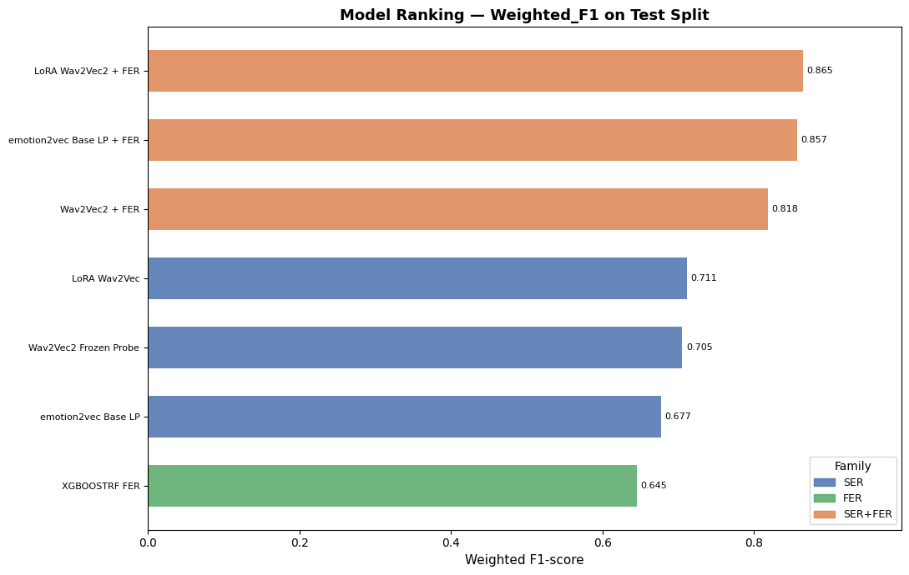

# Multimodal Speech Emotion Recognition with Late Fusion of Self-Supervised Audio Models and Visual Blendshape Features on RAVDESS

Tharen Emmanuel Candi tharenemmanuel.candi@studenti.unipd.it

## 1. Introduction


Speech Emotion Recognition (SER) is a critical component for many downstream applications, but it requires a deep understanding of intricate paralinguistic cues and pushes the limits of vocal acoustic variability. Consequently, SER remains a strong benchmark for evaluating speech foundation models (SFMs), as it tests the richness of their embedding spaces. It also serves a candidate task for the application of multimodal models, as human emotion recognition is inherently multimodal.

Using the RAVDESS dataset as a benchmark, we evaluate the effectiveness of self-supervised encoders, comparing a general SFM (wav2vec 2.0) with an emotion-specialized SSL model (emotion2vec). We also evaluate the effectiveness of late fusion  temperature calibrated sum fusion) with a facial emotion recognition (FER) modality.

This project addresses three primary research questions on the performance of ER on the RAVDESS:

   1. Under matched data splits and labels, how does frozen wav2vec 2.0 compare to LoRA-adapted wav2vec 2.0?
   2. How does an emotion2vec linear probe compare to general wav2vec-based pipelines?
   3. Does calibrated late fusion with a visual XGBoostRF FER model improve unimodal performance?

All systems in this study use the same actor-disjoint split, labels, and test partition.


## 2. Background and Related Work

### 2.1 RAVDESS as an evaluation benchmark

RAVDESS is a validated multimodal emotional dataset with controlled statements, multiple emotions, and explicit intensity levels, recorded from 24 professional actors [1]. Its strengths are recording quality, and balanced class structure; its key limitation is that it remains acted and therefore only partially representative of natural conversational affect [1].

### 2.1.1 Dataset selection rationale for this project

RAVDESS was selected for both scientific and practical reasons:

- It is natively multimodal (audio and video), matching the core question of SER-FER late fusion [1].
- It uses fixed lexical content across emotions, which helps isolate affective cues from language variation [1].
- Its original emotion inventory is balanced, which makes it a cleaner benchmark for controlled model comparison [1].
- It is extensively used as an SER evaluation benchmark, which supports direct comparison with prior work [1,5].
- Its size and structure fit actor-disjoint experiments under project compute constraints [1,5].

### 2.2 Audio representations: general-purpose SSL, emotion-specialized SSL, and parameter-efficient adaptation

wav2vec 2.0 learns contextual speech representations through masked prediction over broad, general-purpose speech corpora (e.g. LibriSpeech, LibriVox-scale data) [2]. Its pretraining objective targets speech structure generally, thus SER performance depends on how well an adapted-classifier-head can recover affect-relevant structure that the encoder was never explicitly optimized to represent. We use the wav2vec2-base checkpoint, following Pepino et al.'s finding that base-scale embeddings give their strongest SER results [5]; the same work also finds that emotion cues are distributed across multiple transformer layers rather than concentrated at the top, which motivates the layer-weighted pooling used in Section 3.5.

In Constrast, emotion2vec uses emotion-centered self-supervised distillation on ~262h of emotion-labeled speech (IEMOCAP, MELD, MEAD, CMU-MOSEI, MSP-Podcast) [3], making it task-aligned by construction. In this project, we use the `iic/emotion2vec_base` checkpoint as a frozen backbone and train a lightweight classifier head on top under the same split/label protocol used for wav2vec.

LoRA offers a middle path for adapting the general-purpose encoder toward the task without the cost of catastrohic forgetting, and overfitting that is risked with full fine-tuning on a small SER datasets [4].

### 2.3 Visual FER with landmarks and blendshapes

Facial blendshape coefficients (52 MediaPipe expression channels) are used instead of raw video as video is computationally expensive and contains substantial variation that is not directly useful for FER (for example background, lighting, and appearance-specific detail). Blendshapes reduce the information to facial-action intensity directly relevant to expression [8]. 

As suported by the Mehrabian  7-38-55 Rule, combining modalities helps disambiguate cases that are ambiguous in audio alone (e.g. laughter vs. scream, sad vs. neutral prosody) [10], which is evaluated in section 4. 

## 3. Methodology

### 3.1 Dataset and label space

- Dataset: RAVDESS speech subset as loaded from xbgoose/ravdess.
- Target classes: angry, disgust, fearful, happy, neutral, sad, surprised.
- Label normalization: calm was merged into neutral across all experiments.

The calm -> neutral merge is justified by the following factors:

- The calm-to-neutral merge is applied uniformly across all experiments to preserve one shared 7-class label space for fair comparison.
- In RAVDESS, calm is introduced as a baseline emotion that is perceptually close to neutral (with potentially mild positive valence) rather than a distinct high-arousal category [1]. 
- Lastly, the merge has precedent in existing SER work on RAVDESS [5]. 

However, the merge introduces a mild class imbalance, so inverse-frequency class weights are used during training of the supervised audio and visual classifiers.

### 3.2 Split protocol

- Split type: actor-disjoint.
- Actor allocation: 16 train, 4 validation, 4 test.
- Sample counts: 960 train, 240 validation, 240 test.
- Random seed: 42.
- Class ratio's balanced across splits

Actor-disjoint partitioning avoids speaker leakage, better tests generalization by preventing actor memorization.

Data loading follows the split protocol directly: `Subset` datasets are wrapped in PyTorch `DataLoader`s with `batch_size=8, shuffle=True` for training and `batch_size=64, shuffle=False` for validation/test. The training loader is shuffled to reduce order effects during optimisation, while validation/test loaders are fixed for deterministic checkpoint selection and reporting. For late fusion, audio and blendshape loaders are both kept ordered (`shuffle=False`) so each batch contains the same utterances in the same order across modalities, guaranteeing 1:1 pairing at fusion time.
Blendshape features were precomputed offline and stored on Google Drive, then matched back to the `xbgoose/ravdess` Hugging Face split indices using an explicit alignment strategy; this prevents cross-split mixing and therefore avoids data leakage in the FER and fusion evaluations.

### 3.3 Audio preprocessing

- Target sample rate: 16 kHz.
- Max duration: 5.27 s (zero-padded or truncated), corresponding to the longest duration found in RAVDESS.


### 3.4 Augmentation

For both wav2vec-based models, SpecAugment was injected through the backbone configuration with `mask_time_prob = 0.05`, `mask_time_length = 15`, `mask_feature_prob = 0.05`, and `mask_feature_length = 12`. Time masking is kept small to avoid removing short prosodic cues that could be important for emotion discrimination.

### 3.5 Audio models

| Model | Backbone | Adaptation strategy |
|---|---|---|
| wav2vec2 weighted-layer linear probe | wav2vec2-base | Backbone frozen; all 13 hidden states are softmax-weighted, then passed through Linear(hidden_size -> 128) + ReLU + Dropout(0.2), mean-pooled over time, and classified with Linear(128 -> 7) [5] |
| LoRA-adapted wav2vec 2.0 | wav2vec2-base | LoRA adapters on attention projections (`q_proj`, `v_proj`) with rank r=4, alpha=4, dropout=0.25, and bias disabled; the same softmax-weighted 13-layer pooling is used, followed by a sigmoid feature gate, LayerNorm(hidden_size), and Linear(hidden_size -> 7) [4] |
| emotion2vec linear probe | iic/emotion2vec_base | Backbone frozen; pooled embedding (hidden size 768) -> Linear(768 -> 128) + ReLU + Dropout(0.20) + Linear(128 -> 7) |

For the wav2vec-based models, the layer weights are learned over all 13 hidden-state tensors produced by wav2vec2-base: the CNN feature-extractor output plus the 12 transformer layers, following Pepino et al. [5], followed by softmax normalisation. The wav2vec2 weighted-layer linear probe keeps a small 128-dimensional projection head to stay lightweight. The LoRA branch keeps the same layer weighting but adds a feature gate and a direct hidden-size classifier so the effect of backbone adaptation is isolated from changes in downstream capacity.

The LoRA setting is intentionally conservative: r=4 gives each adapted projection only four update directions, which acts as a regulariser on the small training set, and lora_alpha=4 keeps the effective scaling at 1.0. The layer-weighting and feature-gating ideas are taken from the PEFT paper [4], but we keep the downstream classifier intentionally simple, for computational effiency and also so the comparison reflects the effect of the backbone adaptation rather than a larger prediction head.

For emotion2vec, we keep the backbone frozen and train a lightweight classifier head on pooled utterance-level embeddings (hidden size 768):

```
self.head = nn.Sequential(
   nn.Linear(hidden_size, 128),
   nn.ReLU(),
   nn.Dropout(dropout_prob),
   nn.Linear(128, num_classes)
)
```

Unlike wav2vec Exp1, no hidden-layer weighting is used in this branch.

### 3.6 Visual FER model

- Input: facial blendshape sequences extracted from RAVDESS videos.
- Feature design: 369-dimensional summary vector computed as 7 per-channel descriptors over 52 blendshape channels (mean, standard deviation, max, min, range, velocity mean, velocity max) plus 5 inter-group ratios.
- Ratio groups: brow/eye, brow/mouth-jaw, eye/mouth-jaw, cheek-nose/mouth-jaw, and cheek-nose/brow.
- Classifier: XGBRFClassifier with n_estimators=300, learning_rate=1.0, max_depth=10, subsample=0.8, colsample_bytree=0.3, random_state=42, and eval_metric=mlogloss; training uses balanced sample weights.

- We use utterance-level blendshape summary features because visual sequence/deep baselines with neural architecturals (LSTM, GRU, 1D-CNN, MLP) tended to overfit in early investigations.

### 3.7 Late fusion

For each utterance, audio and visual model logits are calibrated and summed:

$$
\hat{y} = \arg\max_c \left( \frac{z^{(a)}_c}{T_a} + \frac{z^{(v)}_c}{T_v} \right)
$$

where $z^{(a)}_c$ and $z^{(v)}_c$ are class logits from audio and visual branches, and $T_a, T_v > 0$ are temperature scaling factors estimated on validation data.
For the emotion2vec branch, audio logits are taken directly from the linear probe head in the shared 7-class label space. Visual logits are taken as pre-softmax XGBoost margins. Both branches are temperature-calibrated before summation.

Hybrid feature-level fusion was not used because it would likely overfit on the available data and is less practical with a tree-based FER branch (XGBoostRF). We therefore use temperature-calibrated logit summation, which is simple, transparent, and reduces magnitude-driven modality dominance [9]; calibration is fit on validation data and applied to the held-out test set.
The same validation split is used for unimodal checkpoint selection and fusion calibration, note that the unimodal branches are frozen before fusion-stage calibration.

### 3.8 Metrics

- Accuracy.
- Macro-F1.
- Macro-precision and macro-recall.
- Per-class precision, recall, F1 from classification reports.
- Additional intensity-stratified accuracy (normal vs strong) for qualitative robustness analysis.

### 3.9 Implementation details

Detailed implementation settings and exact hyperparameters are provided in the accompanying experiment notebook (.ipynb).
Automatic mixed precision (AMP) was used during training for both wav2vec-based models to improve efficiency.
Training used early stopping with patience, and the best validation checkpoint was saved and restored for test evaluation, they are also available on google drive.

For both supervised wav2vec audio runs (weighted-layer linear probe and LoRA wav2vec2), the training hyperparameters were: learning rate 1e-3, weight decay 1e-2, dropout 0.25, maximum epochs 25, early-stopping patience 5, and class weighting enabled.

For both supervised wav2vec audio runs, the training objective was class-weighted cross-entropy loss (PyTorch `CrossEntropyLoss` with inverse-frequency class weights).

Both runs used the AdamW optimiser with a CosineAnnealingLR scheduler.

For the emotion2vec linear probe, we used the same optimizer/loss family but a separate schedule to accommodate slower convergence: learning rate 1e-3, weight decay 1e-4, dropout 0.20, maximum epochs 50, early-stopping patience 10, and class weighting enabled.


## 4. Experimental Results

### 4.1.1 Weighted-F1 comparison chart

Figure 1 visualizes weighted-F1 across all evaluated systems.




### 4.1.2 Main test-set comparison

Table 1 summarizes the reported metrics on the common 240-sample test set.

Abbreviations used in all tables: W2V2-WLP = wav2vec2 weighted-layer linear probe, W2V2-LoRA = LoRA wav2vec2, E2V-LP = emotion2vec linear probe, FER = XGBoostRF visual branch.

| Model | Accuracy | Macro-F1 |
|---|---:|---:|
| W2V2-WLP | 0.7125 | 0.6957 |
| W2V2-LoRA | 0.7250 | 0.7020 |
| E2V-LP | 0.6833 | 0.6681 |
| FER | 0.6500 | 0.6500 |
| W2V2-WLP + FER | 0.8208 | 0.8128 |
| W2V2-LoRA + FER | **0.8667** | **0.8604** |
| E2V-LP + FER | 0.8583 | 0.8536 |

### 4.1.2 Overall precision/recall/F1 metrics

Table 1b reports macro precision/recall/F1 values from the test-set classification reports.

| Model | Macro-Precision | Macro-Recall | Macro-F1 |
|---|---:|---:|---:|
| W2V2-WLP | 0.73 | 0.69 | 0.70 |
| W2V2-LoRA | 0.76 | 0.71 | 0.70 |
| E2V-LP | 0.68 | 0.67 | 0.67 |
| FER | 0.70 | 0.67 | 0.65 |
| W2V2-WLP + FER | 0.84 | 0.81 | 0.81 |
| W2V2-LoRA + FER | **0.87** | **0.86** | **0.86** |
| E2V-LP + FER | 0.86 | 0.85 | 0.85 |

As shown in Table 1b, macro metrics are consistent with the headline accuracy ranking in Table 1. For wav2vec-based systems, late fusion improves macro precision/recall/F1. The same pattern also holds for the emotion2vec linear probe, where fusion improves macro-F1 from 0.67 to 0.85.

### 4.2 FER class evaluation

The XGBoostRF FER model achieved 0.65 test accuracy and showed uneven class behavior:

- High class recall: happy (1.00), sad (0.84), angry (0.84).
- Low class recall: neutral (0.42), surprised (0.34).

The class-wise performance of FER is complementary to the audio models, which helps explain the gains from multimodal fusion.

### 4.3 Fusion analysis (overall + class-level)

To keep the interpretation compact, overall gains and class-level changes are summarized together:

- wav2vec2 weighted-layer linear probe: fusion improves accuracy from 0.7125 to 0.8208 (+0.1083), with largest recall gains on happy (+0.41), sad (+0.25), and disgust (+0.12).
- LoRA wav2vec 2.0: fusion improves accuracy from 0.7250 to 0.8667 (+0.1417), with largest recall gains on happy (+0.56), sad (+0.19), disgust (+0.16), and fearful (+0.10).
- emotion2vec linear probe: fusion improves accuracy from 0.6833 to 0.8583 (+0.1750), with largest recall gains on happy (+0.56), sad (+0.31), and angry (+0.16).

Overall, fusion helps all three audio branches, with the largest absolute gain observed for the emotion2vec linear probe in this run.

### 4.4 Class-specific precision/recall/F1 (standalone models)

Table 1c reports class-specific precision/recall/F1 for standalone models.

| Class | W2V2-WLP (P/R/F1) | W2V2-LoRA (P/R/F1) | E2V-LP (P/R/F1) | FER (P/R/F1) |
|---|---:|---:|---:|---:|
| angry | 0.67 / 0.94 / 0.78 | 0.65 / 1.00 / 0.79 | 0.62 / 0.72 / 0.67 | **0.87 / 0.84 / 0.86** |
| disgust | **0.84 / 0.66 / 0.74** | 0.73 / 0.50 / 0.59 | 0.66 / 0.66 / 0.66 | 0.78 / 0.66 / 0.71 |
| fearful | 0.84 / 0.50 / 0.63 | **0.81 / 0.81 / 0.81** | 0.80 / 0.75 / 0.77 | 0.58 / 0.56 / 0.57 |
| happy | 0.71 / 0.53 / 0.61 | 1.00 / 0.38 / 0.55 | 0.56 / 0.44 / 0.49 | **0.78 / 1.00 / 0.88** |
| neutral | **0.73 / 0.98 / 0.84** | **0.74 / 0.96 / 0.84** | 0.72 / 0.92 / 0.81 | 0.95 / 0.42 / 0.58 |
| sad | 0.47 / 0.53 / 0.50 | 0.47 / 0.50 / 0.48 | 0.43 / 0.38 / 0.40 | **0.40 / 0.84 / 0.55** |
| surprised | 0.85 / 0.72 / 0.78 | 0.90 / 0.81 / 0.85 | **0.96 / 0.81 / 0.88** | 0.50 / 0.34 / 0.41 |

### 4.4.1 Class-specific precision/recall/F1 (fusion models)

Table 1d reports class-specific precision/recall/F1 for fusion models.

| Class | W2V2-WLP + FER (P/R/F1) | W2V2-LoRA + FER (P/R/F1) | E2V-LP + FER (P/R/F1) |
|---|---:|---:|---:|
| angry | **0.88 / 0.94 / 0.91** | 0.82 / 1.00 / 0.90 | 0.80 / 0.88 / 0.84 |
| disgust | **0.93 / 0.78 / 0.85** | 0.84 / 0.66 / 0.74 | 0.86 / 0.75 / 0.80 |
| fearful | 0.94 / 0.50 / 0.65 | **0.88 / 0.91 / 0.89** | 0.93 / 0.81 / 0.87 |
| happy | 0.88 / 0.94 / 0.91 | **1.00 / 0.94 / 0.97** | 0.86 / 1.00 / 0.93 |
| neutral | 0.84 / 0.96 / 0.89 | **0.87 / 0.98 / 0.92** | 0.85 / 0.96 / 0.90 |
| sad | 0.57 / 0.78 / 0.66 | 0.69 / 0.69 / 0.69 | **0.73 / 0.69 / 0.71** |
| surprised | 0.86 / 0.78 / 0.82 | 1.00 / 0.84 / 0.92 | **1.00 / 0.88 / 0.93** |

Class-level outcomes show that fusion benefits are uneven across emotions, with especially large gains for LoRA on happy, fearful, and sad, while already strong classes show smaller absolute changes.

### 4.5 Intensity-stratified results

Reported accuracies by emotional intensity are shown in Table 2.

| Model | Normal | Strong |
|---|---:|---:|
| W2V2-WLP | 0.6406 | 0.7946 |
| W2V2-WLP + FER | 0.7422 | **0.9107** |
| W2V2-LoRA | 0.6406 | 0.8214 |
| W2V2-LoRA + FER | **0.8359** | 0.9018 |
| E2V-LP | 0.5781 | 0.8036 |
| E2V-LP + FER | 0.8203 | 0.9018 |
| FER | 0.6406 | 0.6607 |

Observation: most models perform better on strong expressions than on normal intensity, consistent with the known difficulty of SER on subtle affective states.

## 5. Discussion

LoRA wav2vec2 remains stronger than the wav2vec2 weighted-layer linear probe both unimodally and after fusion. LoRA wav2vec2 improves from 0.7250 to 0.8667 with FER (+0.1417), while the wav2vec2 weighted-layer linear probe improves from 0.7125 to 0.8208 (+0.1083).

At class level, the LoRA fusion model shows especially large recall gains for happy, sad, and disgust (Table 1d vs Table 1c), while also improving fearful recall, which is consistent with broader cross-modal error correction rather than a narrow single-class effect.

The emotion2vec linear probe baseline is weaker than both wav2vec baselines in unimodal form (0.6833 accuracy), but benefits strongly from fusion (+0.1750 accuracy), reaching 0.8583 and approaching LoRA wav2vec2 + FER.

Therefore, the findings do not support emotion-specific-SSL to be better for SER than wav2vec.2 style pretraining. However, we are limited in our analysis by not reporting variance between seeds or cross-validation. 


## 6. Limitations

1. Dataset scope: only RAVDESS is evaluated.
2. Domain realism: acted emotions differ from spontaneous conversation.
3. Statistical uncertainty: no repeated-seed confidence intervals reported in the result log or k-fold-actor-disjoint-cross-validation.
4. Although fusion substantially improves the emotion2vec linear probe, this branch remains below LoRA wav2vec2 + FER on overall accuracy and should be re-evaluated with repeated seeds to confirm stability.

## 7. Conclusion

This study presents a controlled multimodal SER evaluation on RAVDESS with unified labels and speaker-disjoint splits. The three research questions are answered as follows. 

- RQ1: under matched splits and labels, LoRA wav2vec2 outperforms the wav2vec2 weighted-layer linear probe unimodally (0.7250 vs 0.7125 accuracy; 0.7020 vs 0.6957 macro-F1), and this advantage carries over to fusion, where LoRA wav2vec2 + FER outperforms wav2vec2 weighted-layer linear probe + FER (0.8667 vs 0.8208). 
- RQ2: under matched splits and labels (with experiment-specific training schedules), the emotion2vec linear probe underperforms both wav2vec-based audio pipelines (0.6833 vs 0.7125 and 0.7250 accuracy; 0.6681 vs 0.6957 and 0.7020 macro-F1).

- RQ3: calibrated late fusion improves all unimodal audio branches (+0.1083 for the wav2vec2 weighted-layer linear probe, +0.1417 for LoRA wav2vec2, and +0.1750 for the emotion2vec linear probe), with LoRA wav2vec2 + FER remaining the best wav2vec-based fusion system (0.8667 accuracy).

Future work could evaluate:

- the RAVDESS song subset, to test whether the same models generalise to song emotion recognition and other emotion-based tasks
- actor-disjoint k-fold cross-validation, as the main evaluation upgrade
- repeated-seed runs, to estimate uncertainty
- cross-lingual SER on a dataset in a different language


## References

1. Livingstone, S. R., and Russo, F. A. (2018). The Ryerson Audio-Visual Database of Emotional Speech and Song (RAVDESS): A dynamic, multimodal set of facial and vocal expressions in North American English. PLOS ONE, 13(5), e0196391.
2. Baevski, A., Zhou, H., Mohamed, A., and Auli, M. (2020). wav2vec 2.0: A framework for self-supervised learning of speech representations. NeurIPS.
3. Ma, Z., Zheng, Z., Ye, J., Li, J., Gao, Z., Zhang, S., and Chen, X. (2024). emotion2vec: Self-supervised pre-training for speech emotion representation. Findings of ACL.
4. Lashkarashvili, N., Wu, W., Sun, G., and Woodland, P. C. (2024). Parameter efficient finetuning for speech emotion recognition and domain adaptation. ICASSP.
5. Pepino, L., Riera, P., and Ferrer, L. (2021). Emotion recognition from speech using wav2vec 2.0 embeddings. Interspeech.
6. Attrah, S. (2025). Emotion estimation from video footage with LSTM. arXiv. DOI: 10.48550/arXiv.2501.13432.
7. Frajtag, I., Svaco, M., and Suligoj, F. (2025). Evaluation of facial landmark localization performance in a surgical setting. arXiv. DOI: 10.48550/arXiv.2507.18248.
8. Mukhiddinov, M., Djuraev, O., Akhmedov, F., Mukhamadiyev, A., and Cho, J. (2023). Masked face emotion recognition based on facial landmarks and deep learning approaches for visually impaired people. Sensors, 23(3), 1080. DOI: 10.3390/s23031080.
9. Liu, W., Chen, Y., Shi, J., and Yue, X. (2026). Beyond Magnitude: Scale-Invariant Evidential Fusion for Multi-View Classification. Proceedings of the 43rd International Conference on Machine Learning (PMLR 306).
10. Course Notes (2026). Multimodal Speech Technologies: Audio-Visual-Text Fusion, Disambiguation, and Speech-LLM Integration. University lecture notes.
