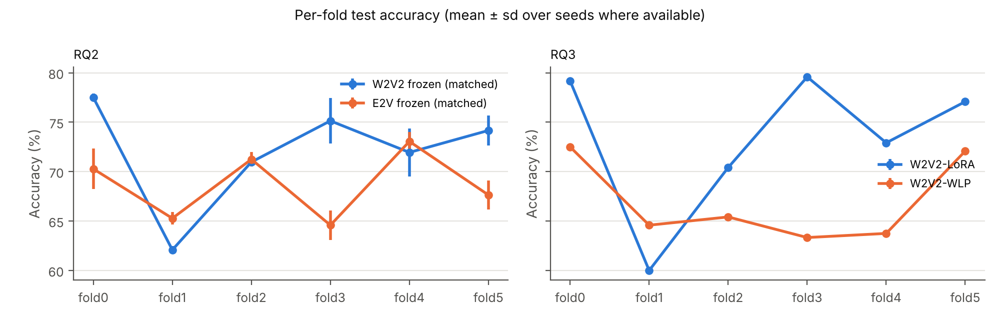
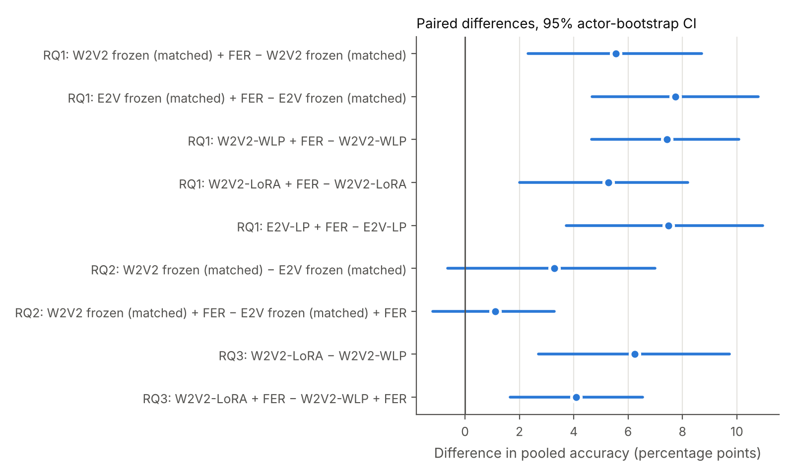
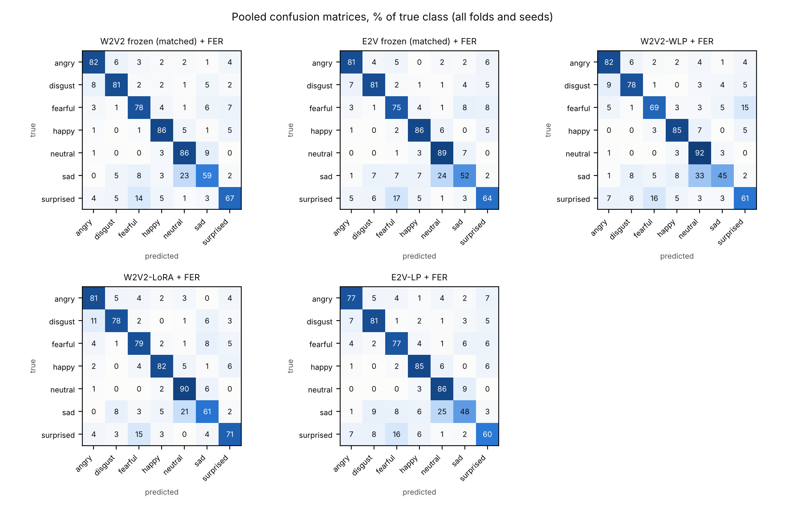

# Multimodal Speech Emotion Recognition with Late Fusion of Self-Supervised Audio Models and Visual Blendshape Features on RAVDESS

Tharen Emmanuel Candi tharenemmanuel.candi@studenti.unipd.it

## 1. Introduction

Speech Emotion Recognition (SER) is a critical component for many downstream applications, but it requires a deep understanding of intricate paralinguistic cues and pushes the limits of vocal acoustic variability. Consequently, SER remains a strong benchmark for evaluating speech foundation models (SFMs), as it tests the richness of their embedding spaces. It also serves as a candidate task for the application of multimodal models, as human emotion recognition is inherently multimodal.

Using the RAVDESS dataset as a benchmark, we evaluate temperature-calibrated late fusion of self-supervised speech encoders with a facial emotion recognition (FER) model built on MediaPipe blendshapes, and compare a general SFM (wav2vec 2.0) with an emotion-specialised SSL model (emotion2vec).

Every system is evaluated with **6-fold actor-wise cross-validation**, so that every actor is tested exactly once by models that never saw them, with 95% confidence intervals from an actor-level bootstrap. The two speech encoders are compared both within their own pipelines and under a **matched probe and training recipe**.

This project addresses three research questions:

1. **RQ1 (main).** Does temperature-calibrated late fusion with the blendshape + XGBoost-RF face model improve SER across actors?
2. **RQ2.** Under a matched probe and recipe, how do frozen wav2vec 2.0 and frozen emotion2vec compare?
3. **RQ3.** For wav2vec 2.0, does LoRA adaptation improve over a frozen weighted-layer probe?

## 2. Background and Related Work

### 2.1 RAVDESS as an evaluation benchmark

RAVDESS is a validated multimodal emotional dataset with controlled statements, multiple emotions, and explicit intensity levels, recorded from 24 professional actors [1]. Its strengths are recording quality and balanced class structure; its key limitation is that it remains acted and therefore only partially representative of natural conversational affect [1].

### 2.1.1 Dataset selection rationale for this project

RAVDESS was selected for both scientific and practical reasons:

- It is natively multimodal (audio and video), matching the core question of SER-FER late fusion [1].
- It uses fixed lexical content across emotions, which helps isolate affective cues from language variation [1].
- Its full emotion inventory is balanced, which makes it a cleaner benchmark for controlled model comparison [1].
- It is extensively used as an SER evaluation benchmark, which supports comparison with prior work [1,5].
- Its size and structure fit actor-disjoint experiments under project compute constraints [1,5].

### 2.2 Audio representations: general-purpose SSL, emotion-specialised SSL, and parameter-efficient adaptation

wav2vec 2.0 learns contextual speech representations through masked prediction over broad, general-purpose speech corpora (e.g. LibriSpeech, LibriVox-scale data) [2]. Its pretraining objective targets speech structure generally, thus SER performance depends on how well an adapted classifier head can recover affect-relevant structure that the encoder was never explicitly optimised to represent. We use the wav2vec2-base checkpoint, following Pepino et al.'s finding that base-scale embeddings give their strongest SER results [5]; the same work also finds that emotion cues are distributed across multiple transformer layers rather than concentrated at the top, which motivates the layer-weighted pooling used in Section 3.4.

In contrast, emotion2vec uses emotion-centered self-supervised distillation on ~262h of emotional speech (IEMOCAP, MELD, MEAD, CMU-MOSEI, MSP-Podcast) [3], making it task-aligned by construction. We use the `iic/emotion2vec_base` checkpoint as a frozen backbone, not the emotion2vec+ checkpoints, which are fine-tuned for classification with a teacher that has seen RAVDESS.

LoRA offers a middle path for adapting the general-purpose encoder toward the task without the catastrophic forgetting and overfitting risked by full fine-tuning on small SER datasets [4].

### 2.3 Visual FER with landmarks and blendshapes

Facial blendshape coefficients (52 MediaPipe expression channels) are used instead of raw video as video is computationally expensive and contains substantial variation that is not directly useful for FER (for example background, lighting, and appearance-specific detail). Blendshapes reduce the information to facial-action intensity directly relevant to expression [8].

As supported by the Mehrabian 7-38-55 rule, combining modalities helps disambiguate cases that are ambiguous in audio alone (e.g. laughter vs. scream, sad vs. neutral prosody) [10], which is evaluated in Section 4.2.

### 2.4 Evaluation protocols on RAVDESS

RAVDESS has 24 actors, so any single actor-disjoint split tests only a handful of speakers and its result depends on which speakers those are. Luna-Jiménez et al. [11] evaluated speech and facial-action-unit models on RAVDESS with subject-wise 5-fold cross-validation, but with no separate test set: the held-out actors of each fold served both for early stopping and for reporting, and seeds were not repeated. The protocol here keeps validation and test actors separate in every fold, so model selection never sees the reported actors, and repeats the cheaper systems over three seeds. Numbers from the two protocols are therefore not directly comparable; Appendix B runs the face model of this study on their exact folds.

## 3. Methodology

### 3.1 Dataset and label space

- Dataset: RAVDESS speech subset as loaded from xbgoose/ravdess (1440 clips, 24 actors).
- Target classes: angry, disgust, fearful, happy, neutral, sad, surprised.
- Label normalisation: calm was merged into neutral across all experiments.

The calm -> neutral merge is justified by the following factors:

- The calm-to-neutral merge is applied uniformly across all experiments to preserve one shared 7-class label space for fair comparison.
- In RAVDESS, calm is introduced as a baseline emotion that is perceptually close to neutral (with potentially mild positive valence) rather than a distinct high-arousal category [1].
- Lastly, the merge has precedent in existing SER work on RAVDESS [5].

However, the merge introduces a mild class imbalance (neutral has 1.5× the clips of every other class), so inverse-frequency class weights are used during training of the supervised audio and visual classifiers.

### 3.2 Evaluation protocol: actor-wise cross-validation

- **Folds.** Six folds of four test actors each, every fold 2 male and 2 female (in RAVDESS odd actor ids are male, even are female). Fold *k* validates on the test actors of fold *k+1* (also 2M/2F) and trains on the remaining 16 actors. Every actor is tested exactly once and used for validation exactly once. The assignment is fixed by a seed (42) and stored in `results_cv/folds.json`.

| Fold | Test actors | Validation actors |
|---|---|---|
| 0 | 1, 12, 15, 24 | 6, 10, 13, 19 |
| 1 | 6, 10, 13, 19 | 7, 16, 20, 23 |
| 2 | 7, 16, 20, 23 | 4, 5, 11, 18 |
| 3 | 4, 5, 11, 18 | 9, 14, 21, 22 |
| 4 | 9, 14, 21, 22 | 2, 3, 8, 17 |
| 5 | 2, 3, 8, 17 | 1, 12, 15, 24 |

- **No leakage.** Checkpoint selection, hyperparameter selection and fusion temperatures use the validation actors of the fold only.
- **Seeds.** Systems that train on cached frozen features (the two matched probes and E2V-LP), the FER model and their fusions are run with three seeds (42, 43, 44). Systems that need the backbone in the training loop (W2V2-WLP, whose backbone runs in train mode, and W2V2-LoRA) are run with seed 42 only, so their seed variance is not measured. Fusions of a single-seed speech system use the seed-42 FER model. Seeds control PyTorch, NumPy, Python, CUDA and the XGBoost model.

Data loading follows the split protocol directly: training batches of 8 clips are shuffled with a seeded generator, validation and test batches are ordered. For late fusion the audio and blendshape outputs are matched by clip, and the clip indices and labels of both modalities are checked to be identical before fusion.

### 3.3 Audio preprocessing

- Target sample rate: 16 kHz.
- Max duration: 5.27 s, corresponding to the longest clip in RAVDESS.
- Pipeline systems (Section 3.4.1): clips are zero-padded to 5.27 s and then normalised by the wav2vec2 feature extractor over the whole padded array, so the padding becomes a small non-zero constant that these probes average over.
- Matched protocol: each clip is normalised (zero mean, unit variance) over its own samples and fed at its true length (Section 3.4.2).

### 3.4 Audio models

#### 3.4.1 Pipeline systems

Three speech systems, each with its own head and a fixed training recipe (Section 3.8):

| Model | Backbone | Adaptation strategy |
|---|---|---|
| wav2vec2 weighted-layer linear probe (W2V2-WLP) | wav2vec2-base | Backbone frozen; all 13 hidden states are softmax-weighted, then passed through Linear(768 -> 128) + ReLU + Dropout(0.25), mean-pooled over time, and classified with Linear(128 -> 7) [5] |
| LoRA-adapted wav2vec 2.0 (W2V2-LoRA) | wav2vec2-base | LoRA adapters on `q_proj` and `v_proj` with r = 4, alpha = 4, dropout 0.25, bias disabled; the same softmax-weighted 13-layer pooling, followed by a sigmoid feature gate, LayerNorm(768) and Linear(768 -> 7) [4] |
| emotion2vec linear probe (E2V-LP) | iic/emotion2vec_base | Backbone frozen; final-layer output mean-pooled -> Linear(768 -> 128) + ReLU + Dropout(0.20) + Linear(128 -> 7) |

The LoRA hyperparameters follow Lashkarashvili et al. [4] and were fixed a priori, not tuned: r = 4 gives each adapted projection four update directions, which acts as a regulariser on the small training set, and alpha = 4 keeps the effective scaling at 1.0. The LoRA head differs from the frozen probe's head, so W2V2-LoRA vs W2V2-WLP compares two pipelines rather than isolating the effect of adaptation.

The W2V2-WLP backbone is frozen but kept in train mode, so its dropout, LayerDrop and SpecAugment stay active during training. The E2V-LP backbone runs in eval mode with no padding mask; its final-layer output, averaged over all frames of the padded input, is deterministic and is therefore computed once and cached.

For both wav2vec 2.0 systems, SpecAugment was injected through the backbone configuration with `mask_time_prob = 0.05`, `mask_time_length = 15`, `mask_feature_prob = 0.05`, and `mask_feature_length = 12`. Time masking is kept small to avoid removing short prosodic cues that could be important for emotion discrimination.

#### 3.4.2 Matched protocol for the backbone comparison (RQ2)

The pipeline systems differ in more than the encoder: the wav2vec 2.0 probe reads all 13 hidden states while the emotion2vec probe reads only the last layer, the heads are arranged differently, the training recipes differ, and the wav2vec 2.0 backbone runs in train mode while emotion2vec runs in eval mode. To compare the encoders fairly, both are frozen and trained with an identical probe and recipe:

- **Probe.** One shared probe class: learned softmax weights over all 13 hidden states each backbone exposes, then Linear(768 -> 128) -> ReLU -> Dropout -> Linear(128 -> 7). For wav2vec2-base these are the CNN/positional output and the 12 transformer layers; for emotion2vec_base the input to the first transformer block, the 4 context-encoder blocks and the 8 main blocks, read with forward hooks.
- **Masked pooling.** Each clip is fed at its true length, so no padding enters either backbone and the time average covers valid frames only.
- **Backbone mode.** Both backbones are frozen and in eval mode (no internal dropout, LayerDrop or SpecAugment). No augmentation is used for either backbone: wav2vec 2.0's SpecAugment acts inside the backbone with a learned mask embedding, emotion2vec's masking is a different mechanism, and in-backbone masking cannot be matched between them.
- **Recipe.** AdamW, cosine schedule, class-weighted cross-entropy, batch 8, AMP, weight decay 1e-2, up to 30 epochs with patience 6. Both backbones get the same 4-setting grid (learning rate ∈ {1e-3, 3e-4} × dropout ∈ {0.1, 0.3}), selected per fold and seed by the lowest validation loss.

Because the frozen backbones are deterministic in eval mode, their pooled hidden states are computed once per clip and cached.

Table 1 lists the trainable parameters. The two matched probes have identical sizes (99,348), within 13 parameters of E2V-LP.

**Table 1.** Trainable and frozen parameters.

| System | Layer weights | Gate | LoRA | Head | **Trainable** | Frozen backbone |
|---|---:|---:|---:|---:|---:|---:|
| W2V2 frozen, matched probe | 13 | 0 | 0 | 99,335 | **99,348** | 94,370,944 |
| E2V frozen, matched probe | 13 | 0 | 0 | 99,335 | **99,348** | 93,790,988 |
| W2V2-WLP | 13 | 0 | 0 | 99,335 | **99,348** | 94,371,712 |
| W2V2-LoRA | 13 | 768 | 147,456 | 6,919 | **155,156** | 94,371,712 |
| E2V-LP | 0 | 0 | 0 | 99,335 | **99,335** | 93,790,988 |

LoRA was not evaluated under the matched protocol. Matching it would remove SpecAugment, which cannot be matched across the two backbones and which the LoRA recipe relies on against overfitting; a matched LoRA variant without SpecAugment was started, then discarded, and is not reported. The backbone comparison (RQ2) therefore uses frozen encoders only.

### 3.5 Visual FER model

- Input: facial blendshape sequences extracted from RAVDESS videos with MediaPipe Face Landmarker.
- Feature design: 376-dimensional summary vector computed as 7 per-channel descriptors over 53 blendshape channels (mean, standard deviation, max, min, range, velocity mean, velocity max) plus 5 inter-group ratios. The 53 channels are the 52 ARKit blendshapes plus MediaPipe's `_neutral` score; `tongueOut` is zero-filled when absent.
- Ratio groups: brow/eye, brow/mouth-jaw, eye/mouth-jaw, cheek-nose/mouth-jaw, and cheek-nose/brow.
- Classifier: XGBRFClassifier with n_estimators=300, learning_rate=1.0, max_depth=10, subsample=0.8, colsample_bytree=0.3, eval_metric=mlogloss and random_state set to the run seed; training uses balanced sample weights.
- Audio-video alignment: each audio clip is joined to the blendshapes of its own recording on (raw emotion, intensity, statement, repetition, actor). The raw emotion is needed because neutral exists only at normal intensity: a key built after merging calm into neutral would pair each calm/normal clip with the face of the neutral recording of the same actor and sentence.

We use utterance-level blendshape summary features because visual sequence/deep baselines with neural architectures (LSTM, GRU, 1D-CNN, MLP) tended to overfit in early investigations.

### 3.6 Late fusion

For each utterance, the audio and visual logits are temperature-calibrated, converted to probabilities and summed:

$$
\hat{y} = \arg\max_c \left( \mathrm{softmax}\left(\frac{z^{(a)}}{T_a}\right)_c + \mathrm{softmax}\left(\frac{z^{(v)}}{T_v}\right)_c \right)
$$

where $z^{(a)}$ and $z^{(v)}$ are the class-logit vectors from the audio and visual branches (pre-softmax XGBoost margins for the visual branch), and $T_a, T_v > 0$ are temperatures fitted on the validation actors of the same fold by minimising cross-entropy. The temperatures are parametrised as $T = e^{\tau}$ and fitted with L-BFGS and a strong-Wolfe line search, which keeps them positive. (Optimising $T$ directly with a fixed step can diverge to negative temperatures, which would invert the probabilities.) The fitted temperatures range from 0.30 to 1.73.

Hybrid feature-level fusion was not used because it would likely overfit on the available data and is less practical with a tree-based FER branch (XGBoostRF). We therefore use temperature-calibrated probability summation, which is simple, transparent, and reduces magnitude-driven modality dominance [9].

### 3.7 Metrics and statistics

- Accuracy and macro-F1, per fold × seed run (4 test actors, 240 clips) and pooled over all 24 actors (1440 clips per seed, averaged over the system's seeds).
- **Confidence intervals:** cluster bootstrap over actors (10,000 resamples, stratified by gender); a resampled actor brings all of its clips.
- **Paired comparisons** on the same clips: difference in pooled accuracy with a paired actor-bootstrap CI and two-sided bootstrap p-value (Holm-adjusted within each table); per-fold differences with Wilcoxon signed-rank test, rank-biserial r and Cohen's $d_z$; exact McNemar tests on the pooled predictions. Comparisons use the seeds both systems have: all three when both are multi-seed, seed 42 otherwise. With 6 folds the smallest possible two-sided Wilcoxon p is 0.031, and McNemar ignores the grouping of clips by actor, so the verdicts below rest on the actor bootstrap (95% CI excluding 0 and Holm-adjusted p < 0.05).
- Per-class recall, pooled confusion matrices, and accuracy by emotional intensity (normal vs strong).

### 3.8 Implementation details

The experiments ran on Google Colab (NVIDIA L4 and A100 GPUs) with automatic mixed precision. Each run's test logits, predictions, validation loss, epochs, trainable parameters and wall time are saved as it finishes, so interrupted sessions resume without retraining; the analysis reads only these saved outputs. Hidden states are recorded per encoder layer, so a LayerDrop-skipped layer repeats the previous state and every probe sees 13 states regardless of the transformers version. Code, fold assignment and all results are in the repository (`cv/`, `notebook/ser_fer_fusion_ravdess_cv.ipynb`, `results_cv/`). The extracted blendshapes (2880 CSV files, one per RAVDESS speech video) are available at https://drive.google.com/drive/folders/1omlBivvIL68xhqAdRY5lSjJNIO8DaIN7 (CC BY-NC-SA 4.0, as RAVDESS).

Pipeline recipes (fixed in advance, not tuned): both wav2vec 2.0 systems use learning rate 1e-3, weight decay 1e-2, dropout 0.25, at most 25 epochs and patience 5; the emotion2vec probe uses learning rate 1e-3, weight decay 1e-4, dropout 0.20, at most 50 epochs and patience 10. All use class-weighted cross-entropy, AdamW and a cosine schedule, with early stopping on validation loss and restoration of the best checkpoint. One pipeline run took about 7.5 min (frozen wav2vec 2.0) and 5 min (LoRA) on an L4; a cached-feature probe takes seconds.

## 4. Experimental Results

Abbreviations: W2V2 = wav2vec 2.0, E2V = emotion2vec, WLP = weighted-layer probe, LP = linear probe, FER = blendshape + XGBoost-RF face model. "Matched" refers to the protocol of Section 3.4.2.

### 4.1 Main results

**Table 2.** Accuracy and macro-F1 over the 6 folds. Mean ± sd is over fold × seed runs (fold variation only for single-seed systems). Pooled = all 24 actors, mean over the system's seeds, with 95% actor-bootstrap CI. All values in %.

| System | Seeds | Acc. mean ± sd | Macro-F1 mean ± sd | Pooled acc. [95% CI] | Pooled macro-F1 [95% CI] |
|---|---:|---:|---:|---:|---:|
| W2V2 frozen, matched probe | 3 | 72.0 ± 5.2 | 71.5 ± 4.7 | 72.0 [66.8, 76.6] | 71.6 [67.0, 76.0] |
| E2V frozen, matched probe | 3 | 68.7 ± 3.4 | 67.1 ± 3.7 | 68.7 [65.3, 71.7] | 67.5 [64.3, 70.4] |
| W2V2-WLP | 1 | 66.9 ± 4.2 | 64.6 ± 5.1 | 66.9 [63.7, 70.0] | 64.9 [61.4, 68.1] |
| W2V2-LoRA | 1 | 73.2 ± 7.4 | 72.6 ± 7.0 | 73.2 [69.1, 76.9] | 72.7 [68.9, 76.4] |
| E2V-LP | 3 | 66.9 ± 3.2 | 65.1 ± 4.0 | 66.9 [63.5, 70.3] | 65.5 [62.4, 68.6] |
| FER | 3 | 60.4 ± 6.3 | 58.5 ± 6.7 | 60.4 [56.6, 64.3] | 58.9 [54.5, 63.0] |
| W2V2 matched + FER | 3 | 77.5 ± 5.1 | 76.8 ± 5.5 | 77.5 [73.7, 81.4] | 76.9 [72.9, 81.0] |
| E2V matched + FER | 3 | 76.4 ± 5.8 | 75.0 ± 6.7 | 76.4 [72.8, 80.0] | 75.4 [71.5, 79.2] |
| W2V2-WLP + FER | 1 | 74.4 ± 5.5 | 72.9 ± 6.3 | 74.4 [71.0, 77.8] | 73.0 [69.2, 76.9] |
| W2V2-LoRA + FER | 1 | **78.5 ± 6.6** | **77.6 ± 6.7** | **78.5 [75.0, 81.9]** | **77.8 [74.2, 81.4]** |
| E2V-LP + FER | 3 | 74.4 ± 5.3 | 73.1 ± 5.9 | 74.4 [71.1, 77.6] | 73.3 [69.7, 76.7] |

For the three-seed systems, the pooled accuracy varies by less than 1 point between seeds (sd 0.3–0.8 points speech-only, 0.3–0.6 points fused); the spread across folds, i.e. across test actors, is several times larger.

### 4.2 RQ1: late fusion with FER

**Table 3.** Fusion gain (fused − speech only) on the same clips, pooled and per test fold (mean over seeds where available), in percentage points.

| Speech system | Seeds | Speech | Fused | Gain [95% CI] | p (Holm) | F0 | F1 | F2 | F3 | F4 | F5 | Folds > 0 |
|---|---|---:|---:|---:|---:|---:|---:|---:|---:|---:|---:|---:|
| W2V2 matched | 42–44 | 72.0 | 77.5 | +5.6 [+2.3, +8.7] | 0.001 | +5.1 | +9.6 | +6.4 | −4.2 | +7.1 | +9.3 | 5/6 |
| E2V matched | 42–44 | 68.7 | 76.4 | +7.7 [+4.7, +10.8] | <0.001 | +9.6 | +8.1 | +8.3 | +0.6 | +7.4 | +12.5 | 6/6 |
| W2V2-WLP | 42 | 66.9 | 74.4 | +7.4 [+4.7, +10.1] | <0.001 | +5.0 | +4.6 | +8.3 | +3.8 | +13.3 | +9.6 | 6/6 |
| W2V2-LoRA | 42 | 73.2 | 78.5 | +5.3 [+2.0, +8.2] | 0.003 | +7.5 | +12.1 | +5.8 | −7.5 | +4.6 | +9.2 | 5/6 |
| E2V-LP | 42–44 | 66.9 | 74.4 | +7.5 [+3.7, +10.9] | <0.001 | +10.6 | +6.8 | +6.7 | +1.8 | +9.0 | +10.0 | 6/6 |

Fusion improves pooled accuracy for every speech system, by 5.3 to 7.7 points, and every 95% CI excludes zero. The gain is positive in every test fold for three of the five systems (both emotion2vec probes and W2V2-WLP); for E2V-LP it is positive in all 18 fold × seed runs. The exception is fold 3 (test actors 4, 5, 11, 18), where the face model is at its weakest (53.5% accuracy) while the two wav2vec 2.0 systems are among their best folds (75.1% and 79.6%): there fusion costs the matched wav2vec 2.0 probe 4.2 points and the LoRA model 7.5 points. Every fused system is also far above the face model alone (+13.7 to +17.8 points, every CI excluding zero, and better in every fold and every fold × seed run).

The modalities remain complementary at the class level (Table 6): the face model recognises happy (83% recall) far better than any speech model (41–57%), while speech is much better on surprised (69–80% vs 32%) and fearful (61–79% vs 52%). Fusion lifts happy recall to 82–86% for every speech system; surprised loses 8–14 points against speech alone because the face model often mislabels it.

### 4.3 RQ2: frozen wav2vec 2.0 vs frozen emotion2vec under the matched protocol

**Table 4.** Paired comparison under the matched protocol (wav2vec 2.0 − emotion2vec), three seeds, 6 folds.

| Comparison | Δ accuracy [95% CI] | p (Holm) | Δ macro-F1 [95% CI] | Folds W2V2 better | Wilcoxon p (r) |
|---|---:|---:|---:|---:|---:|
| Speech only | +3.3 [−0.6, +7.0] | 0.201 | +4.1 [+0.3, +7.9] | 3/6 | 0.438 (+0.43) |
| Fused with FER | +1.1 [−1.2, +3.3] | 0.331 | +1.5 [−0.7, +3.7] | 3/6 | 0.438 (+0.43) |

With the same probe, recipe and search budget, frozen wav2vec 2.0 scores 3.3 points higher than frozen emotion2vec, but the difference is not reliable: the actor-bootstrap CI includes zero and wav2vec 2.0 wins in only three of six folds (per-fold differences +7.2, −3.2, −0.3, +10.6, −1.1, +6.5). Macro-F1 points the same way, and its CI just excludes zero (+0.3 to +7.9); we treat accuracy as the primary metric. After fusion the gap shrinks to 1.1 points. Validation selected the same learning rate (1e-3) for both backbones in every fold and seed. The matched probe also helps wav2vec 2.0 relative to the W2V2-WLP pipeline (+4.7 points, seed 42), whereas for emotion2vec reading all 13 layers adds only +1.8 points over the final-layer probe (CI includes zero; Appendix A).

### 4.4 RQ3: LoRA vs frozen weighted-layer probe (wav2vec 2.0)

**Table 5.** LoRA pipeline − frozen weighted-layer probe pipeline, each with its own recipe and SpecAugment, seed 42, 6 folds.

| Comparison | Δ accuracy [95% CI] | p (Holm) | Δ macro-F1 [95% CI] | Folds LoRA better | Wilcoxon p (r) |
|---|---:|---:|---:|---:|---:|
| Speech only | +6.2 [+2.7, +9.7] | <0.001 | +7.9 [+4.1, +11.7] | 5/6 | 0.062 (+0.90) |
| Fused with FER | +4.1 [+1.7, +6.5] | <0.001 | +4.8 [+2.1, +7.5] | 6/6 | 0.031 (+1.00) |

The LoRA pipeline is reliably better than the frozen weighted-layer probe, both alone (+6.2 points, better in five of six folds) and fused (+4.1 points, better in every fold). Since the two pipelines differ in their heads as well as in adaptation, and LoRA was run with one seed, this supports "the LoRA pipeline outperforms the frozen-probe pipeline" rather than a clean effect of adaptation alone.

### 4.5 Per-class recall and confusion matrices

**Table 6.** Recall per class, pooled over all folds and each system's seeds (%).

| Class | W2V2 matched | E2V matched | W2V2-WLP | W2V2-LoRA | E2V-LP | FER | W2V2 m. + FER | E2V m. + FER | WLP + FER | LoRA + FER | E2V-LP + FER |
|---|---:|---:|---:|---:|---:|---:|---:|---:|---:|---:|---:|
| angry | 79 | 76 | 80 | 79 | 72 | 74 | 82 | 81 | 82 | 81 | 77 |
| disgust | 78 | 73 | 68 | 72 | 74 | 64 | 81 | 81 | 78 | 78 | 81 |
| fearful | 79 | 74 | 61 | 78 | 76 | 52 | 78 | 75 | 69 | 79 | 77 |
| happy | 56 | 44 | 43 | 57 | 41 | 83 | 86 | 86 | 85 | 82 | 85 |
| neutral | 76 | 82 | 90 | 82 | 81 | 70 | 86 | 89 | 92 | 90 | 86 |
| sad | 59 | 53 | 40 | 61 | 48 | 41 | 59 | 52 | 45 | 61 | 48 |
| surprised | 77 | 72 | 75 | 80 | 69 | 32 | 67 | 64 | 61 | 71 | 60 |

Sad remains the hardest class for every system (40–61% recall) and fusion does not help it, since the face model is also weak on sad (41%). Pooled confusion matrices are in `results_cv/` (`fig_confusion_speech.png`, `fig_confusion_fer.png`, `fig_confusion_fused.png`).

### 4.6 Intensity-stratified results

**Table 7.** Accuracy by emotional intensity (%), pooled per seed and averaged over seeds; ± is the sd over fold × seed runs.

| System | Normal | Strong |
|---|---:|---:|
| W2V2 matched | 67.4 ± 5.7 | 77.1 ± 5.3 |
| W2V2 matched + FER | 74.7 ± 4.7 | 80.8 ± 5.6 |
| E2V matched | 64.4 ± 3.0 | 73.6 ± 5.5 |
| E2V matched + FER | 74.2 ± 4.6 | 78.9 ± 7.4 |
| W2V2-WLP | 62.6 ± 4.0 | 71.9 ± 5.0 |
| W2V2-WLP + FER | 71.4 ± 5.5 | 77.8 ± 6.0 |
| W2V2-LoRA | 68.1 ± 9.1 | 79.0 ± 6.7 |
| W2V2-LoRA + FER | **75.8 ± 4.3** | **81.5 ± 9.3** |
| E2V-LP | 63.2 ± 3.3 | 71.1 ± 5.3 |
| E2V-LP + FER | 71.0 ± 4.0 | 78.3 ± 7.3 |
| FER | 58.9 ± 6.2 | 62.1 ± 7.4 |

Every speech model is 8–11 points more accurate on strong than on normal-intensity clips, while the face model is nearly intensity-independent (58.9% vs 62.1%). Fusion therefore helps most on the subtle, normal-intensity clips (+7.3 to +9.8 points) and less on strong ones (+2.5 to +7.2 points).

## 5. Discussion

**Fusion (RQ1).** Adding the face model improves every speech system across actors, by +5.3 to +7.7 points with confidence intervals that exclude zero, and the gain comes from complementary errors (the face model is strong on happy and weak on surprised and fearful, the reverse of speech). Fusion also depends on the face model being competitive on the test actors: in fold 3, where FER is weakest and wav2vec 2.0 does well, fusion with equal weights lowers the two wav2vec 2.0 systems' accuracy.

**Backbones (RQ2).** Compared as their own pipelines, E2V-LP is level with W2V2-WLP and 5.7 points behind W2V2-LoRA (Appendix A), but those comparisons mix the encoder with the probe, the recipe and the backbone mode. Under a matched probe and recipe, frozen wav2vec 2.0 is ahead by 3.3 points, but the difference is within the uncertainty from 24 actors and the per-fold results split three to three. On RAVDESS, we cannot distinguish the two frozen encoders; emotion-specific pretraining shows no advantage, and no clear disadvantage either.

**LoRA (RQ3).** The LoRA pipeline is reliably better than the frozen weighted-layer probe pipeline, by 6.2 points alone and 4.1 points after fusion. Because the two differ in their heads and LoRA has one seed, this is evidence for the pipeline as a whole rather than for adaptation in isolation.

**Face model against published work.** On the exact actor folds and 8 classes of Luna-Jiménez et al. [11], the blendshape forest reaches 57.9%, about 4 points below their AU + bi-LSTM model (62.13%) and 2 points below their static MLP (60.22%), without using held-out actors for model selection (Appendix B). The face model is therefore in the range of published face-only results, not an unusually weak or strong branch.

**Best system.** LoRA wav2vec 2.0 + FER is the most accurate system (78.5%), but not reliably better than the matched frozen wav2vec 2.0 probe + FER (difference +0.4 points on seed 42, CI −1.5 to +2.4); the matched frozen probe reaches almost the same accuracy with a third fewer trainable parameters and no backbone in the training loop.

## 6. Limitations

1. Single seed for backbone-in-the-loop systems: W2V2-WLP and W2V2-LoRA were run with one seed, so their seed variance is unknown and RQ3 rests on one seed per fold.
2. LoRA was not evaluated under the matched protocol, so the backbone comparison covers frozen encoders only, and RQ3 compares whole pipelines with different heads.
3. Statistical power: the 6 folds share training actors, so per-fold results are not independent, and 24 actors leave substantial uncertainty about new speakers. McNemar treats clips as independent and ignores grouping by actor; verdicts use the actor bootstrap instead.
4. Dataset scope: only RAVDESS is evaluated, with acted, studio-recorded North-American English speech and fixed sentences; results may not carry over to spontaneous or conversational emotion.

## 7. Conclusion

This study presents a cross-validated multimodal SER evaluation on RAVDESS with unified labels, speaker-disjoint folds, separate validation and test actors, and actor-level confidence intervals. The three research questions are answered as follows.

- **RQ1:** calibrated late fusion with the blendshape face model improves every speech system across actors, by +5.3 to +7.7 accuracy points (all 95% CIs above zero), and in every test fold for three of the five systems. Fusion can hurt on actors whose faces the FER model reads poorly.
- **RQ2:** under a matched probe and recipe, frozen wav2vec 2.0 and frozen emotion2vec are not reliably different (+3.3 points, CI −0.6 to +7.0; +1.1 points after fusion). Emotion-specific pretraining gives no measurable advantage here.
- **RQ3:** for wav2vec 2.0, the LoRA pipeline outperforms the frozen weighted-layer probe pipeline both alone (+6.2 points) and fused (+4.1 points), with the caveats of one seed and different heads.

The best system, LoRA wav2vec 2.0 + FER, reaches 78.5% (95% CI 75.0–81.9) over all 24 actors.

Future work could evaluate:

- LoRA under the matched protocol with matched augmentation, and repeated seeds for the backbone-in-the-loop systems
- learned or validation-tuned fusion weights, to avoid losses on actors where one modality is weak
- the RAVDESS song subset and other emotion datasets, including cross-lingual SER

## Appendix A. Other paired comparisons

| A | B | Seeds | Δ accuracy [95% CI] | p (Holm) |
|---|---|---|---:|---:|
| W2V2-WLP | E2V-LP | 42 | −0.6 [−4.0, +2.8] | 0.778 |
| W2V2-LoRA | E2V-LP | 42 | +5.7 [+1.4, +9.8] | 0.046 |
| W2V2 matched probe | W2V2-WLP | 42 | +4.7 [+1.0, +8.3] | 0.046 |
| E2V matched probe | E2V-LP | 42–44 | +1.8 [−0.3, +3.9] | 0.201 |

## Appendix B. FER-only comparison under the published protocol

The face model alone (same features and XGBRF settings, seeds 42–44) was re-run with 8 classes (calm kept apart from neutral) and with 7, on the 6 folds of this study and on the 5 actor folds of Luna-Jiménez et al. [11]: held-out actors (2, 5, 14, 15, 16), (3, 6, 7, 13, 18), (10, 11, 12, 19, 20), (8, 17, 21, 23, 24), (1, 4, 9, 22). Each fold trains on all remaining actors; XGBRF has fixed hyperparameters and no early stopping, so no validation actors are needed and the held-out actors are used only for testing. Fold mean is the mean of per-fold accuracies (their aggregation) ± sd across folds; pooled is over all 1440 clips with a 95% actor-bootstrap CI; both are averaged over seeds.

| Protocol | Classes | Fold-mean acc. ± sd | Pooled acc. [95% CI] | Pooled macro-F1 [95% CI] |
|---|---:|---:|---:|---:|
| Luna-Jiménez et al. 5 folds | 8 | 57.9 ± 3.4 | 58.1 [53.9, 62.6] | 57.6 [52.9, 62.4] |
| Luna-Jiménez et al. 5 folds | 7 | 59.2 ± 2.8 | 59.4 [55.8, 63.2] | 57.8 [53.7, 62.0] |
| 6-fold CV (this study), test actors only | 8 | 60.2 ± 5.9 | 60.2 [56.9, 63.4] | 59.0 [55.0, 62.6] |
| 6-fold CV (this study), test actors only | 7 | 61.4 ± 7.4 | 61.4 [57.5, 65.5] | 60.1 [55.8, 64.3] |

| Face-only, 8 classes, Luna-Jiménez et al. folds | Accuracy (fold mean) |
|---|---:|
| Luna-Jiménez et al. [11]: OpenFace AUs + bi-LSTM | 62.13 |
| Luna-Jiménez et al. [11]: static MLP | 60.22 |
| This study: MediaPipe blendshape statistics + XGBRF (3 seeds) | 57.9 |

The comparison is indicative: the face features differ (MediaPipe blendshape statistics here, OpenFace action units in [11]), and no held-out actors were used for model selection in these runs, whereas in [11] they also served for early stopping (Section 2.4).

Calm and neutral are separable from the face to a moderate degree. On their folds, calm recall is 62.3% and neutral recall 57.3%; only 4.3% of calm clips are predicted as neutral and 7.3% of neutral clips as calm (6-fold CV: 67.2% and 50.3% recall, 4.5% and 7.6% confusion). Neutral is confused more with sad (21% of neutral clips) than with calm.

These runs train on 20 or 19 actors per fold instead of the 16 of the main protocol, which holds out 4 validation actors; this is why the 7-class 6-fold figure here (61.4%) differs from the 60.4% of Table 2.

## References

1. Livingstone, S. R., and Russo, F. A. (2018). The Ryerson Audio-Visual Database of Emotional Speech and Song (RAVDESS): A dynamic, multimodal set of facial and vocal expressions in North American English. PLOS ONE, 13(5), e0196391.
2. Baevski, A., Zhou, H., Mohamed, A., and Auli, M. (2020). wav2vec 2.0: A framework for self-supervised learning of speech representations. NeurIPS.
3. Ma, Z., Zheng, Z., Ye, J., Li, J., Gao, Z., Zhang, S., and Chen, X. (2024). emotion2vec: Self-supervised pre-training for speech emotion representation. Findings of ACL.
4. Lashkarashvili, N., Wu, W., Sun, G., and Woodland, P. C. (2024). Parameter efficient finetuning for speech emotion recognition and domain adaptation. ICASSP.
5. Pepino, L., Riera, P., and Ferrer, L. (2021). Emotion recognition from speech using wav2vec 2.0 embeddings. Interspeech.
6. Attrah, S. (2025). Emotion estimation from video footage with LSTM. arXiv. DOI: 10.48550/arXiv.2501.13432.
7. Frajtag, I., Svaco, M., and Suligoj, F. (2025). Evaluation of facial landmark localization performance in a surgical setting. arXiv. DOI: 10.48550/arXiv.2507.18248.
8. Mukhiddinov, M., Djuraev, O., Akhmedov, F., Mukhamadiyev, A., and Cho, J. (2023). Masked face emotion recognition based on facial landmarks and deep learning approaches for visually impaired people. Sensors, 23(3), 1080. DOI: 10.3390/s23031080.
9. Liu, W., Chen, Y., Shi, J., and Yue, X. (2026). Beyond Magnitude: Scale-Invariant Evidential Fusion for Multi-View Classification. Proceedings of the 43rd International Conference on Machine Learning (PMLR 306).
10. Course Notes (2026). Multimodal Speech Technologies: Audio-Visual-Text Fusion, Disambiguation, and Speech-LLM Integration. University lecture notes.
11. Luna-Jiménez, C., Kleinlein, R., Griol, D., Callejas, Z., Montero, J. M., and Fernández-Martínez, F. (2022). A proposal for multimodal emotion recognition using aural transformers and action units on RAVDESS dataset. Applied Sciences, 12(1), 327. DOI: 10.3390/app12010327.
