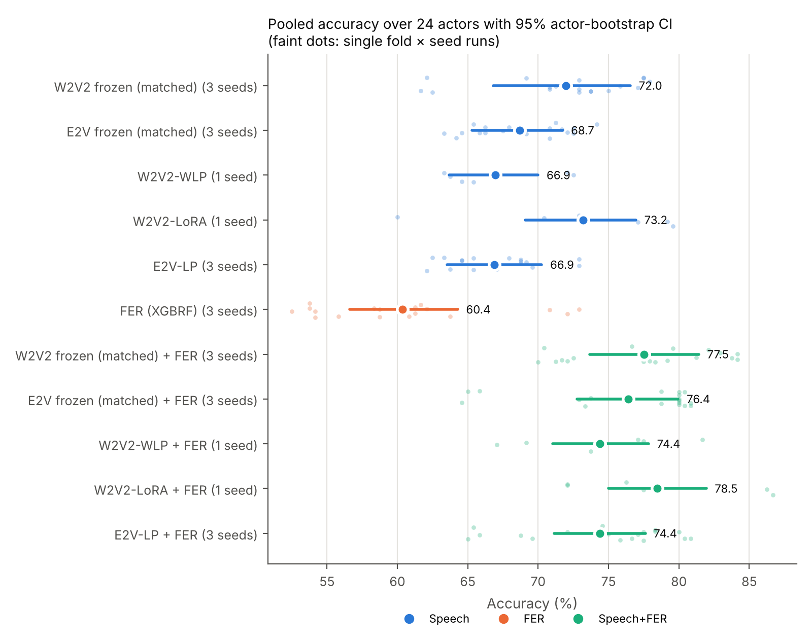
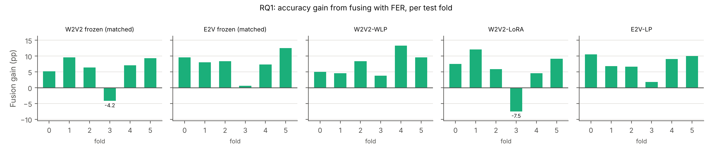
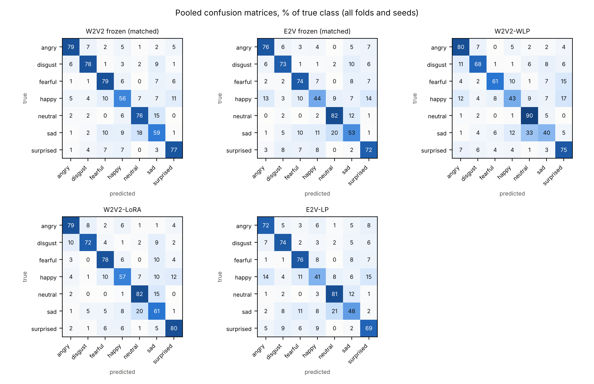
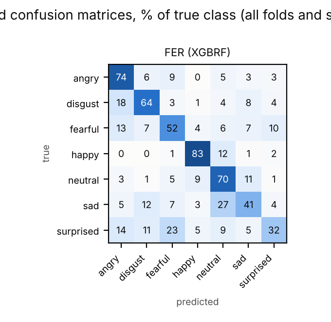
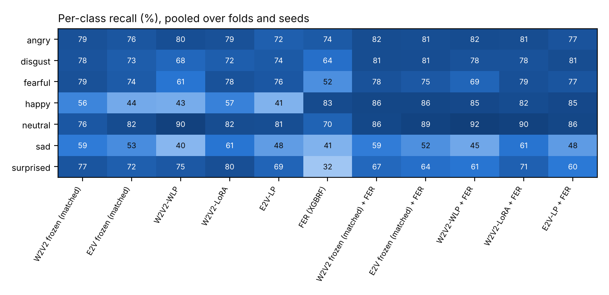

# Actor-wise cross-validation results

_Generated by `cv/analysis.py` from the saved run outputs. Do not edit by hand; re-run the analysis._

## Protocol

- **Cross-validation:** 6-fold actor-wise CV over the 24 RAVDESS actors (1440 speech clips, 7 classes, calm merged into neutral). Each fold tests 4 actors (2 male, 2 female), validates on 4 different actors (2M/2F) and trains on the remaining 16. Every actor is tested exactly once and used for validation exactly once (fold assignment seed 42, `results_cv/folds.json`).
- **No leakage:** checkpoint selection, hyperparameter selection and fusion temperatures use the validation actors only.
- **3 seeds (42, 43, 44):** systems trained on cached frozen features, the FER model and their fusions — W2V2 frozen (matched), E2V frozen (matched), E2V-LP, FER (XGBRF), W2V2 frozen (matched) + FER, E2V frozen (matched) + FER, E2V-LP + FER.
- **Single seed (42):** systems with the backbone in the training loop and their fusions — W2V2-WLP, W2V2-LoRA, W2V2-WLP + FER, W2V2-LoRA + FER. Their seed variance is not measured; their ± values reflect variation across folds only. Fusions of single-seed systems use the seed-42 FER model.
- **LoRA under the matched protocol was not evaluated.** Matching it would remove SpecAugment, which the LoRA recipe relies on against overfitting. The backbone comparison (RQ2) uses frozen encoders only, and RQ3 compares the LoRA and weighted-layer-probe pipelines, each with its own recipe.
- **Statistics:** pooled accuracy is computed over all 24 actors per seed and averaged over the system's seeds; 95% CIs come from a cluster bootstrap over actors (10000 resamples, stratified by gender). Paired comparisons re-score both systems on the seeds they share (all three when both are multi-seed, otherwise seed 42) with the same resampled actors; p-values are Holm-adjusted within each table. With 6 folds the smallest possible two-sided Wilcoxon p is 0.031, so verdicts rest on the actor bootstrap (95% CI excluding 0 and Holm-adjusted p < 0.05).

## 1. Main results

Per-run = one fold x seed (4 test actors, 240 clips); for multi-seed systems the ± mixes fold and seed variation. Pooled = all 24 actors, mean over the system's seeds. All values in %.

| System | Seeds | Acc. mean ± sd | Macro-F1 mean ± sd | Pooled acc. [95% CI] | Pooled macro-F1 [95% CI] |
|---|---:|---:|---:|---:|---:|
| W2V2 frozen (matched) | 3 | 72.0 ± 5.2 | 71.5 ± 4.7 | 72.0 [66.8, 76.6] | 71.6 [67.0, 76.0] |
| E2V frozen (matched) | 3 | 68.7 ± 3.4 | 67.1 ± 3.7 | 68.7 [65.3, 71.7] | 67.5 [64.3, 70.4] |
| W2V2-WLP | 1 | 66.9 ± 4.2 | 64.6 ± 5.1 | 66.9 [63.7, 70.0] | 64.9 [61.4, 68.1] |
| W2V2-LoRA | 1 | 73.2 ± 7.4 | 72.6 ± 7.0 | 73.2 [69.1, 76.9] | 72.7 [68.9, 76.4] |
| E2V-LP | 3 | 66.9 ± 3.2 | 65.1 ± 4.0 | 66.9 [63.5, 70.3] | 65.5 [62.4, 68.6] |
| FER (XGBRF) | 3 | 60.4 ± 6.3 | 58.5 ± 6.7 | 60.4 [56.6, 64.3] | 58.9 [54.5, 63.0] |
| W2V2 frozen (matched) + FER | 3 | 77.5 ± 5.1 | 76.8 ± 5.5 | 77.5 [73.7, 81.4] | 76.9 [72.9, 81.0] |
| E2V frozen (matched) + FER | 3 | 76.4 ± 5.8 | 75.0 ± 6.7 | 76.4 [72.8, 80.0] | 75.4 [71.5, 79.2] |
| W2V2-WLP + FER | 1 | 74.4 ± 5.5 | 72.9 ± 6.3 | 74.4 [71.0, 77.8] | 73.0 [69.2, 76.9] |
| W2V2-LoRA + FER | 1 | 78.5 ± 6.6 | 77.6 ± 6.7 | 78.5 [75.0, 81.9] | 77.8 [74.2, 81.4] |
| E2V-LP + FER | 3 | 74.4 ± 5.3 | 73.1 ± 5.9 | 74.4 [71.1, 77.6] | 73.3 [69.7, 76.7] |

## 2. RQ1 — Does calibrated late fusion with FER improve SER across actors?

Gain = fused − speech only, on the same clips. Per-fold columns are the gain in each test fold (mean over seeds for multi-seed systems), in percentage points.

| Speech system | Seeds | Speech acc. | Fused acc. | Gain [95% CI] | p (boot, Holm) | F0 | F1 | F2 | F3 | F4 | F5 | Folds > 0 | Min fold gain | Verdict |
|---|---|---:|---:|---:|---:|---:|---:|---:|---:|---:|---:|---:|---:|---|
| W2V2 frozen (matched) | 42,43,44 | 72.0 | 77.5 | +5.6 [+2.3, +8.7] | 0.001 | +5.1 | +9.6 | +6.4 | -4.2 | +7.1 | +9.3 | 5/6 | -4.2 | fusion better |
| E2V frozen (matched) | 42,43,44 | 68.7 | 76.4 | +7.7 [+4.7, +10.8] | <0.001 | +9.6 | +8.1 | +8.3 | +0.6 | +7.4 | +12.5 | 6/6 | +0.6 | fusion better |
| W2V2-WLP | 42 | 66.9 | 74.4 | +7.4 [+4.7, +10.1] | <0.001 | +5.0 | +4.6 | +8.3 | +3.8 | +13.3 | +9.6 | 6/6 | +3.7 | fusion better |
| W2V2-LoRA | 42 | 73.2 | 78.5 | +5.3 [+2.0, +8.2] | 0.003 | +7.5 | +12.1 | +5.8 | -7.5 | +4.6 | +9.2 | 5/6 | -7.5 | fusion better |
| E2V-LP | 42,43,44 | 66.9 | 74.4 | +7.5 [+3.7, +10.9] | <0.001 | +10.6 | +6.8 | +6.7 | +1.8 | +9.0 | +10.0 | 6/6 | +1.8 | fusion better |

**Fusion gain is positive in every test fold for 3 of 5 speech systems.** Positive fold × seed runs for multi-seed systems: W2V2 frozen (matched) 15/18; E2V frozen (matched) 17/18; E2V-LP 18/18.

Fused system vs FER alone:

| A | B | Seeds | Δ acc [95% CI] | p (boot, Holm) | Δ macro-F1 [95% CI] | Folds A>B | d_z | Wilcoxon p (r) | McNemar p per seed | Verdict |
|---|---|---|---:|---:|---:|---:|---:|---:|---:|---|
| W2V2 frozen (matched) + FER | FER (XGBRF) | 42,43,44 | +17.2 [+14.1, +20.3] | <0.001 | +18.0 [+14.7, +21.7] | 6/6 | 5.29 | 0.031 (+1.00) | 1.77e-41;5.28e-43;8.72e-39 | A better (CI excludes 0) |
| E2V frozen (matched) + FER | FER (XGBRF) | 42,43,44 | +16.0 [+12.7, +19.4] | <0.001 | +16.5 [+13.0, +20.4] | 6/6 | 3.23 | 0.031 (+1.00) | 7.49e-35;2.22e-41;2.51e-39 | A better (CI excludes 0) |
| W2V2-WLP + FER | FER (XGBRF) | 42 | +13.7 [+10.5, +16.8] | <0.001 | +13.9 [+10.4, +17.6] | 6/6 | 5.16 | 0.031 (+1.00) | 1.04e-27 | A better (CI excludes 0) |
| W2V2-LoRA + FER | FER (XGBRF) | 42 | +17.8 [+14.7, +21.0] | <0.001 | +18.7 [+15.1, +22.6] | 6/6 | 4.22 | 0.031 (+1.00) | 2.65e-41 | A better (CI excludes 0) |
| E2V-LP + FER | FER (XGBRF) | 42,43,44 | +14.0 [+11.6, +16.4] | <0.001 | +14.4 [+11.7, +17.2] | 6/6 | 4.02 | 0.031 (+1.00) | 1.23e-30;9.57e-33;9.24e-28 | A better (CI excludes 0) |

## 3. RQ2 — Frozen wav2vec 2.0 vs frozen emotion2vec under a matched probe and recipe

**Matched protocol** (identical for both backbones):

- *Probe:* one shared probe class — learned softmax weights over all 13 hidden states each backbone exposes (wav2vec2-base: CNN/positional output + 12 transformer layers; emotion2vec_base: input to the first block + 4 context-encoder blocks + 8 blocks, read with forward hooks), then Linear(768→128) → ReLU → Dropout → Linear(128→7).
- *Masked pooling:* each clip is fed at its true length (no padding enters either backbone), so the time average covers valid frames only.
- *Backbones frozen and in eval mode* (no internal dropout, LayerDrop or SpecAugment); no augmentation for either backbone.
- *Recipe:* AdamW, cosine schedule, class-weighted cross-entropy, batch 8, AMP, weight decay 1e-2, up to 30 epochs, patience 6; the same 4-setting grid (lr ∈ {1e-3, 3e-4} × dropout ∈ {0.1, 0.3}) for both, selected per fold and seed by the lowest validation loss.

Trainable parameters (all systems in this document):

| System | Layer weights | Gate | LoRA | Head | **Trainable total** | Frozen backbone |
|---|---:|---:|---:|---:|---:|---:|
| W2V2 frozen (matched) | 13 | 0 | 0 | 99,335 | **99,348** | 94,370,944 |
| E2V frozen (matched) | 13 | 0 | 0 | 99,335 | **99,348** | 93,790,988 |
| W2V2-WLP | 13 | 0 | 0 | 99,335 | **99,348** | 94,371,712 |
| W2V2-LoRA | 13 | 768 | 147,456 | 6,919 | **155,156** | 94,371,712 |
| E2V-LP | 0 | 0 | 0 | 99,335 | **99,335** | 93,790,988 |

Paired comparison (A − B):

| A | B | Seeds | Δ acc [95% CI] | p (boot, Holm) | Δ macro-F1 [95% CI] | Folds A>B | d_z | Wilcoxon p (r) | McNemar p per seed | Verdict |
|---|---|---|---:|---:|---:|---:|---:|---:|---:|---|
| W2V2 frozen (matched) | E2V frozen (matched) | 42,43,44 | +3.3 [-0.6, +7.0] | 0.201 | +4.1 [+0.3, +7.9] | 3/6 | 0.59 | 0.438 (+0.43) | 0.0126;0.0153;0.00237 | no reliable difference |
| W2V2 frozen (matched) + FER | E2V frozen (matched) + FER | 42,43,44 | +1.1 [-1.2, +3.3] | 0.331 | +1.5 [-0.7, +3.7] | 3/6 | 0.33 | 0.438 (+0.43) | 0.0439;0.379;0.578 | no reliable difference |

- Speech only: per-fold Δ fold0 +7.2, fold1 -3.2, fold2 -0.3, fold3 +10.6, fold4 -1.1, fold5 +6.5; wav2vec 2.0 better in 3/6 folds.
- Fused with FER: per-fold Δ fold0 +2.8, fold1 -1.7, fold2 -2.2, fold3 +5.8, fold4 -1.4, fold5 +3.3; wav2vec 2.0 better in 3/6 folds.
- Validation-selected setting (count over fold × seed): E2V frozen (matched): lr1e-03_do0.10 ×14, lr1e-03_do0.30 ×4; W2V2 frozen (matched): lr1e-03_do0.10 ×17, lr1e-03_do0.30 ×1.

## 4. RQ3 — wav2vec 2.0: does LoRA improve over a frozen weighted-layer probe?

LoRA pipeline (r = 4, alpha = 4, dropout 0.25 on q/v projections, following Lashkarashvili et al.; fixed a priori, not tuned) vs the frozen weighted-layer probe, both with their own recipes and SpecAugment, seed 42, paired over the CV folds. The two pipelines have different heads (frame-level MLP vs gate + LayerNorm + linear), so this compares pipelines rather than isolating the effect of adaptation.

| A | B | Seeds | Δ acc [95% CI] | p (boot, Holm) | Δ macro-F1 [95% CI] | Folds A>B | d_z | Wilcoxon p (r) | McNemar p per seed | Verdict |
|---|---|---|---:|---:|---:|---:|---:|---:|---:|---|
| W2V2-LoRA | W2V2-WLP | 42 | +6.2 [+2.7, +9.7] | <0.001 | +7.9 [+4.1, +11.7] | 5/6 | 0.92 | 0.062 (+0.90) | 7.66e-07 | A better (CI excludes 0) |
| W2V2-LoRA + FER | W2V2-WLP + FER | 42 | +4.1 [+1.7, +6.5] | <0.001 | +4.8 [+2.1, +7.5] | 6/6 | 1.38 | 0.031 (+1.00) | 2.87e-05 | A better (CI excludes 0) |

- Speech only: per-fold Δ (LoRA − frozen) fold0 +6.7, fold1 -4.6, fold2 +5.0, fold3 +16.2, fold4 +9.2, fold5 +5.0.
- Fused with FER: per-fold Δ (LoRA − frozen) fold0 +9.2, fold1 +2.9, fold2 +2.5, fold3 +5.0, fold4 +0.4, fold5 +4.6.

## 5. Per-class recall and confusion matrices

Recall pooled over all folds and the system's seeds (%). Confusion matrices: `fig_confusion_speech.png`, `fig_confusion_fer.png`, `fig_confusion_fused.png` and `confusion_matrices.json`.

| Class | W2V2 frozen (matched) | E2V frozen (matched) | W2V2-WLP | W2V2-LoRA | E2V-LP | FER (XGBRF) | W2V2 frozen (matched) + FER | E2V frozen (matched) + FER | W2V2-WLP + FER | W2V2-LoRA + FER | E2V-LP + FER |
|---|---:|---:|---:|---:|---:|---:|---:|---:|---:|---:|---:|
| *seeds* | 3 | 3 | 1 | 1 | 3 | 3 | 3 | 3 | 1 | 1 | 3 |
| angry | 79 | 76 | 80 | 79 | 72 | 74 | 82 | 81 | 82 | 81 | 77 |
| disgust | 78 | 73 | 68 | 72 | 74 | 64 | 81 | 81 | 78 | 78 | 81 |
| fearful | 79 | 74 | 61 | 78 | 76 | 52 | 78 | 75 | 69 | 79 | 77 |
| happy | 56 | 44 | 43 | 57 | 41 | 83 | 86 | 86 | 85 | 82 | 85 |
| neutral | 76 | 82 | 90 | 82 | 81 | 70 | 86 | 89 | 92 | 90 | 86 |
| sad | 59 | 53 | 40 | 61 | 48 | 41 | 59 | 52 | 45 | 61 | 48 |
| surprised | 77 | 72 | 75 | 80 | 69 | 32 | 67 | 64 | 61 | 71 | 60 |

## 6. Accuracy by emotional intensity (%)

Pooled per seed, mean over seeds; ± is the sd over fold × seed runs.

| System | Seeds | Normal | Strong |
|---|---:|---:|---:|
| W2V2 frozen (matched) | 3 | 67.4 ± 5.7 | 77.1 ± 5.3 |
| E2V frozen (matched) | 3 | 64.4 ± 3.0 | 73.6 ± 5.5 |
| W2V2-WLP | 1 | 62.6 ± 4.0 | 71.9 ± 5.0 |
| W2V2-LoRA | 1 | 68.1 ± 9.1 | 79.0 ± 6.7 |
| E2V-LP | 3 | 63.2 ± 3.3 | 71.1 ± 5.3 |
| FER (XGBRF) | 3 | 58.9 ± 6.2 | 62.1 ± 7.4 |
| W2V2 frozen (matched) + FER | 3 | 74.7 ± 4.7 | 80.8 ± 5.6 |
| E2V frozen (matched) + FER | 3 | 74.2 ± 4.6 | 78.9 ± 7.4 |
| W2V2-WLP + FER | 1 | 71.4 ± 5.5 | 77.8 ± 6.0 |
| W2V2-LoRA + FER | 1 | 75.8 ± 4.3 | 81.5 ± 9.3 |
| E2V-LP + FER | 3 | 71.0 ± 4.0 | 78.3 ± 7.3 |

## 7. Best fused system vs runner-up

| A | B | Seeds | Δ acc [95% CI] | p (boot, Holm) | Δ macro-F1 [95% CI] | Folds A>B | d_z | Wilcoxon p (r) | McNemar p per seed | Verdict |
|---|---|---|---:|---:|---:|---:|---:|---:|---:|---|
| W2V2-LoRA + FER | W2V2 frozen (matched) + FER | 42 | +0.4 [-1.5, +2.4] | 0.689 | +0.2 [-1.8, +2.3] | 3/6 | 0.19 | 0.625 (+0.33) | 0.711 | no reliable difference |

Fusion temperatures (T = exp(log T), fitted on the validation actors): 0.30–1.73.

## 8. Relation to prior protocols

Luna-Jiménez et al. (2022) used subject-wise 5-fold cross-validation on RAVDESS with no separate test set: the held-out actors of each fold served both for early stopping and for reporting, and no seeds were repeated. This protocol keeps validation and test actors separate in every fold, so model selection never sees the reported actors, and repeats the cheap systems over three seeds. Numbers from the two protocols are not directly comparable.

## 9. Limitations

- Backbone-in-the-loop systems (W2V2-WLP, W2V2-LoRA) were run with one seed, so their seed-to-seed variance is unknown; RQ3 rests on a single seed.
- LoRA was not evaluated under the matched protocol, so the backbone comparison (RQ2) covers frozen encoders only, and RQ3 compares whole pipelines with different heads.
- The 6 folds share training actors, so per-fold results are not independent, and 24 actors leave substantial uncertainty about new speakers. McNemar treats clips as independent and ignores grouping by actor, so its p-values are optimistic; verdicts use the actor bootstrap.
- RAVDESS is acted, studio-recorded North-American English speech with fixed sentences; results may not carry over to spontaneous or conversational emotion.

## Appendix A. Other paired comparisons

| A | B | Seeds | Δ acc [95% CI] | p (boot, Holm) | Δ macro-F1 [95% CI] | Folds A>B | d_z | Wilcoxon p (r) | McNemar p per seed | Verdict |
|---|---|---|---:|---:|---:|---:|---:|---:|---:|---|
| W2V2-WLP | E2V-LP | 42 | -0.6 [-4.0, +2.8] | 0.778 | -1.4 [-5.2, +2.3] | 1/6 | -0.19 | 0.625 (-0.33) | 0.705 | no reliable difference |
| W2V2-LoRA | E2V-LP | 42 | +5.7 [+1.4, +9.8] | 0.046 | +6.5 [+1.9, +10.9] | 5/6 | 0.79 | 0.156 (+0.71) | 4.43e-05 | A better (CI excludes 0) |
| W2V2 frozen (matched) | W2V2-WLP | 42 | +4.7 [+1.0, +8.3] | 0.046 | +6.5 [+2.9, +10.1] | 5/6 | 0.95 | 0.094 (+0.81) | 3.25e-05 | A better (CI excludes 0) |
| E2V frozen (matched) | E2V-LP | 42,43,44 | +1.8 [-0.3, +3.9] | 0.201 | +2.0 [-0.3, +4.3] | 5/6 | 0.60 | 0.219 (+0.62) | 0.379;0.246;0.0115 | no reliable difference |

## Appendix B. Training statistics

| System | Seeds | Runs | Epochs trained (mean) | Best epoch (mean) | Wall time per run (min) |
|---|---:|---:|---:|---:|---:|
| E2V frozen (matched) | 3 | 18 | 24.1 | 18.1 | 0.2 |
| E2V-LP | 3 | 18 | 41.2 | 31.6 | 0.2 |
| W2V2 frozen (matched) | 3 | 18 | 25.6 | 20.2 | 0.2 |
| W2V2-LoRA | 1 | 6 | 11.0 | 6.0 | 4.9 |
| W2V2-WLP | 1 | 6 | 21.3 | 16.8 | 7.5 |

## Figures

